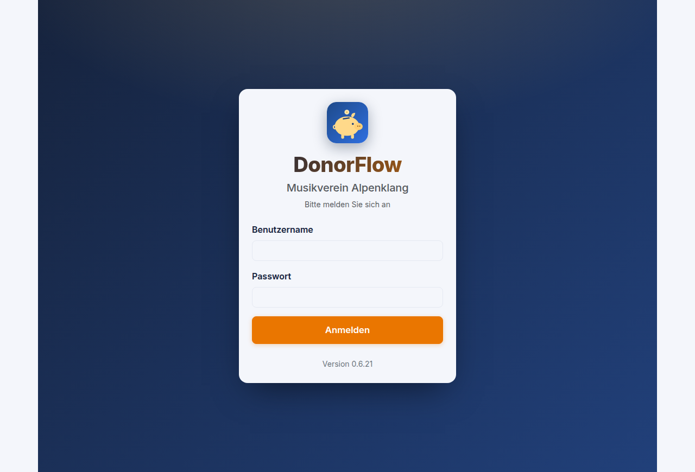
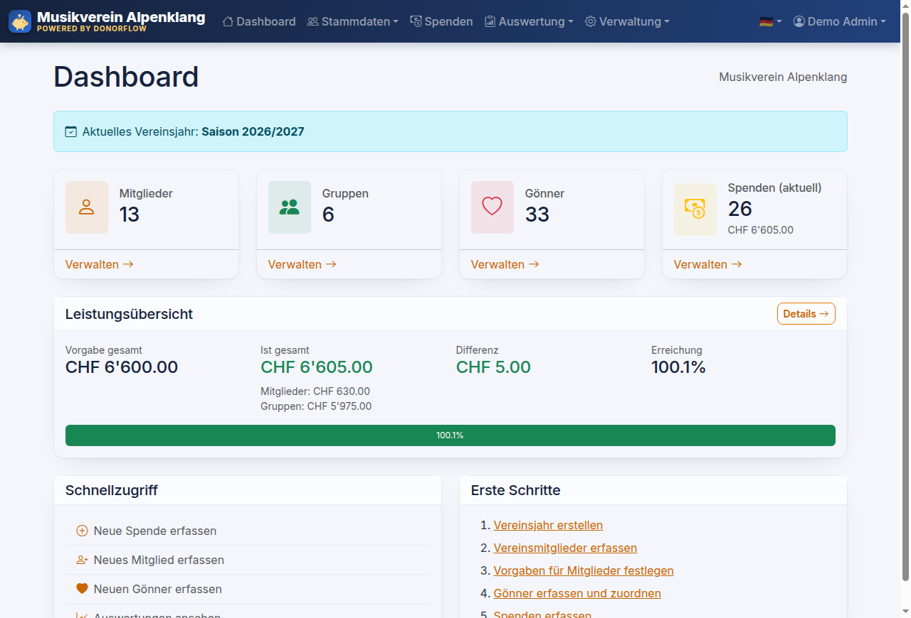
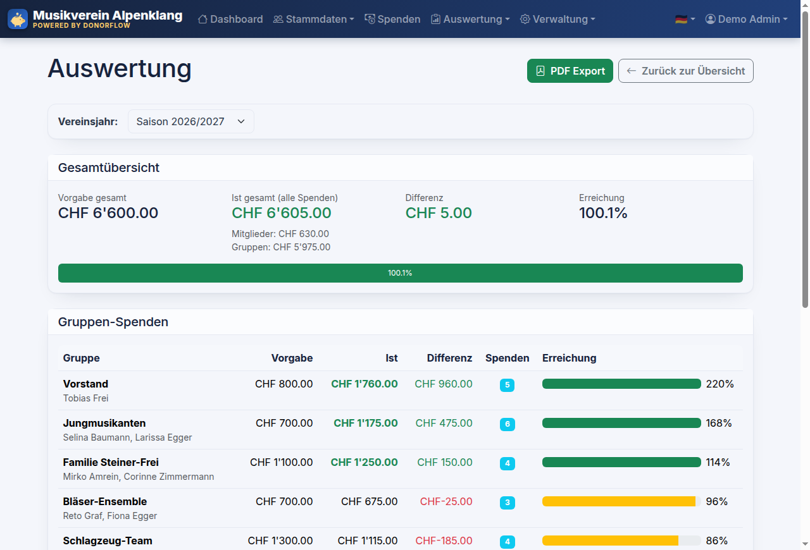
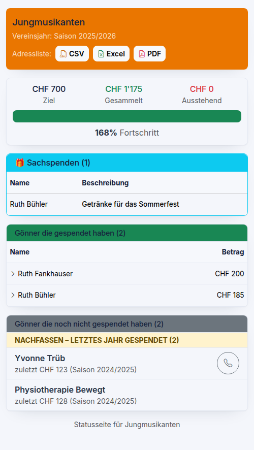
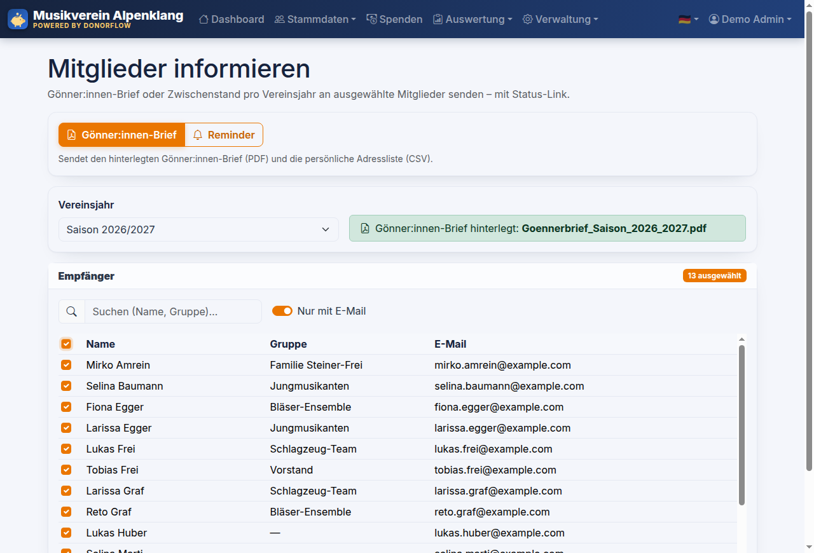
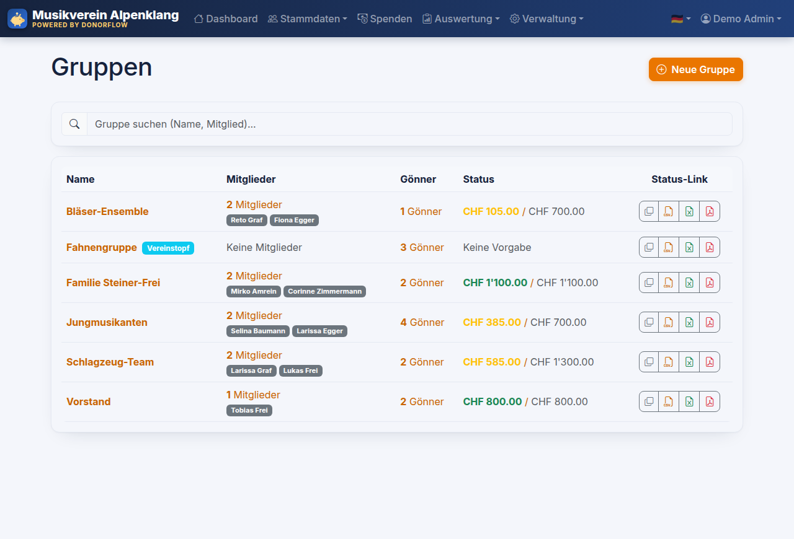
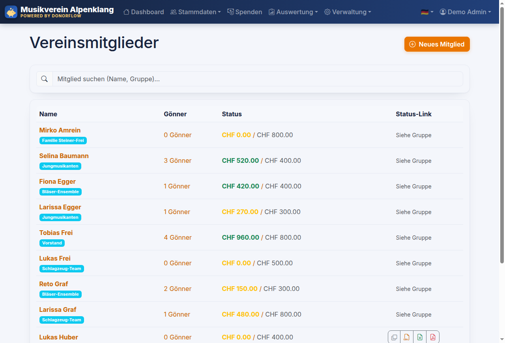
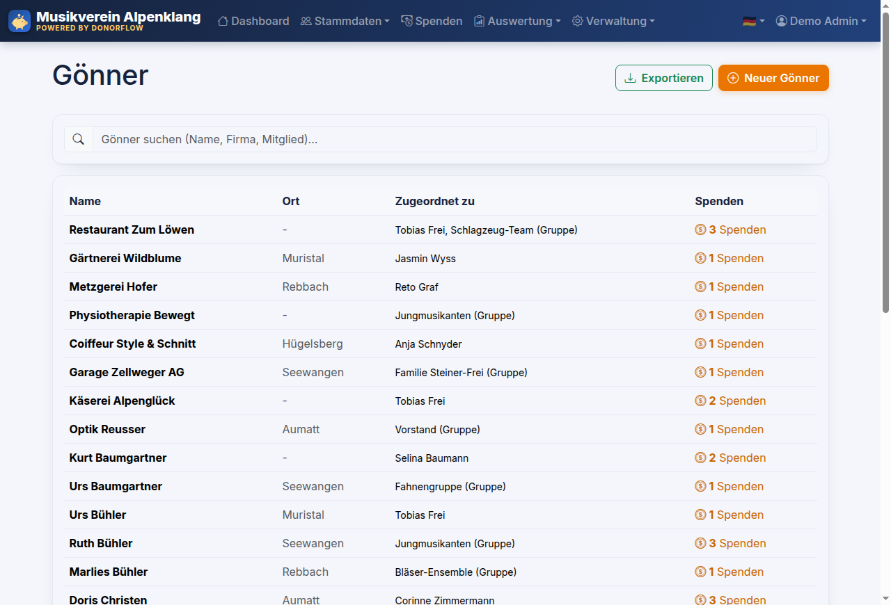
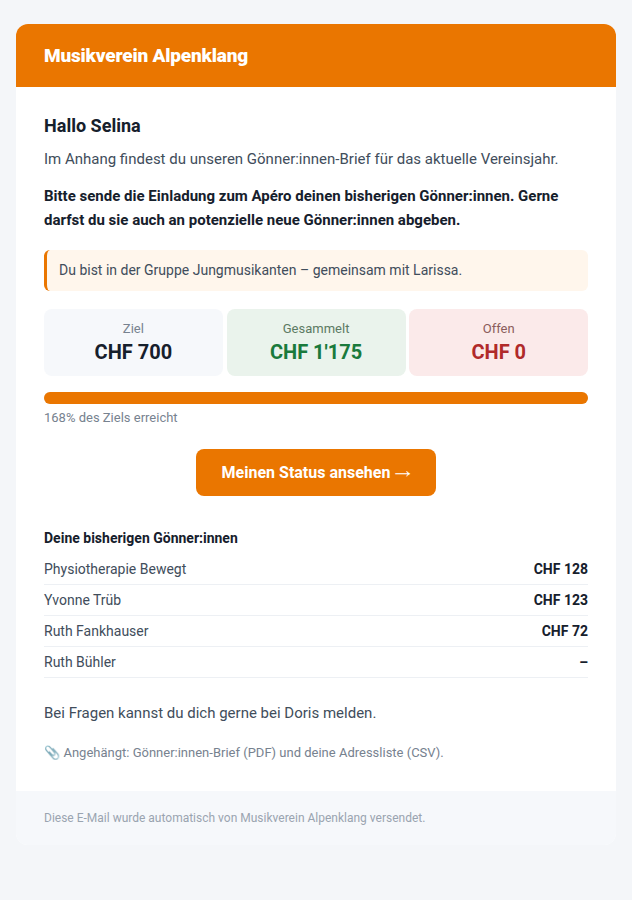
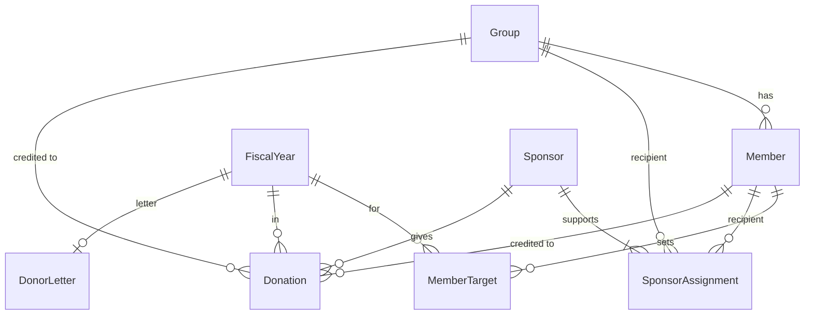

<div align="center">


# DonorFlow

[](https://github.com/moetiker/DonorFlow/actions/workflows/ci.yml)
[](https://github.com/moetiker/DonorFlow/releases/latest)

**Donation management for clubs and associations.**

Track your patrons, set fiscal-year goals, watch the money come in live, and email every member a personalized donor letter in one click. Self-hosted, four languages.

`Next.js 16` · `TypeScript` · `Prisma + SQLite` · `NextAuth` · `React-Bootstrap` · `next-intl`



</div>

## Screenshots

|  |  |
|:--:|:--:|
| **Dashboard** | **Performance report** (PDF export) |
|  |  |
| **Public status link** (mobile, no login) | **Donor mailing** |
|  |  |
| **Groups**: copy the status link, export the address list as CSV, Excel or PDF; dissolved groups keep their history | **Members** |
|  |  |
| **Patrons**: one patron can support several members and groups | |
|  | |

The personalized email each member receives:

<div align="center"></div>

## What it does

- **Members and patrons**: organize members in groups (families, sections); a patron can support several members and groups at once
- **Donations and targets**: monetary and in-kind donations, each credited to exactly one member or group; one target per member per fiscal year; group target = sum of its members' targets
- **Groups over time**: dissolve a group and its donations stay in the reports; a club pool group takes over patrons left without a recipient
- **Reports**: live dashboard and per-member/group performance with **PDF export**
- **Status links**: public, tokenized, mobile-first progress pages per member and group
- **Member mailing**: email selected members the season's letter (PDF) with their status and address list, or a reminder with the current figures; throttled and resumable
- **Four languages**: German, English, French, Italian, auto-detected, locale-aware formatting
- **Self-hosted**: SQLite, no external services

## Quick Start

```bash
cp .env.example .env                              # set NEXTAUTH_SECRET
pnpm install
pnpm db:push
DATABASE_URL="file:./dev.db" pnpm db:seed         # demo data, login demo / demo1234
pnpm dev                                          # http://localhost:7526
```

The seed fills the database with an invented club and replaces whatever it holds. It refuses a `DATABASE_URL` that contains `prod`.

## Deployment

Reproducible Podman build, tar archive, SSH to a systemd user service. Templates in [`deploy/`](deploy/).

```bash
cp deploy/deploy-config.example.sh deploy/deploy-config.production.sh
# edit with your server details, then:
./deploy.sh production
```

It deploys the checked-out release tag (it refuses any other commit), builds Linux binaries in a container, uploads and backs up the previous release, preserves the database/`.env`/logs, syncs the schema, and restarts the service.

## Database Model



A sponsor has one or more assignments, each to a member **or** a group. Every donation is credited to exactly one member or group. Targets are per member per fiscal year, and there is one donor letter per fiscal year. A group with `dissolvedAt` set is dissolved: it has no members, and its donations stay credited to it. One group may be flagged `isClubPool`; a sponsor whose last recipient is deleted is assigned to it. `User`, `Setting` and `MailJob` stand alone; `MailJob` records a fiscal year id as a plain column, not a foreign key.

---

<div align="center">Created by <a href="mailto:manuel@oetiker.ch">Manuel Oetiker</a> · MIT License</div>
